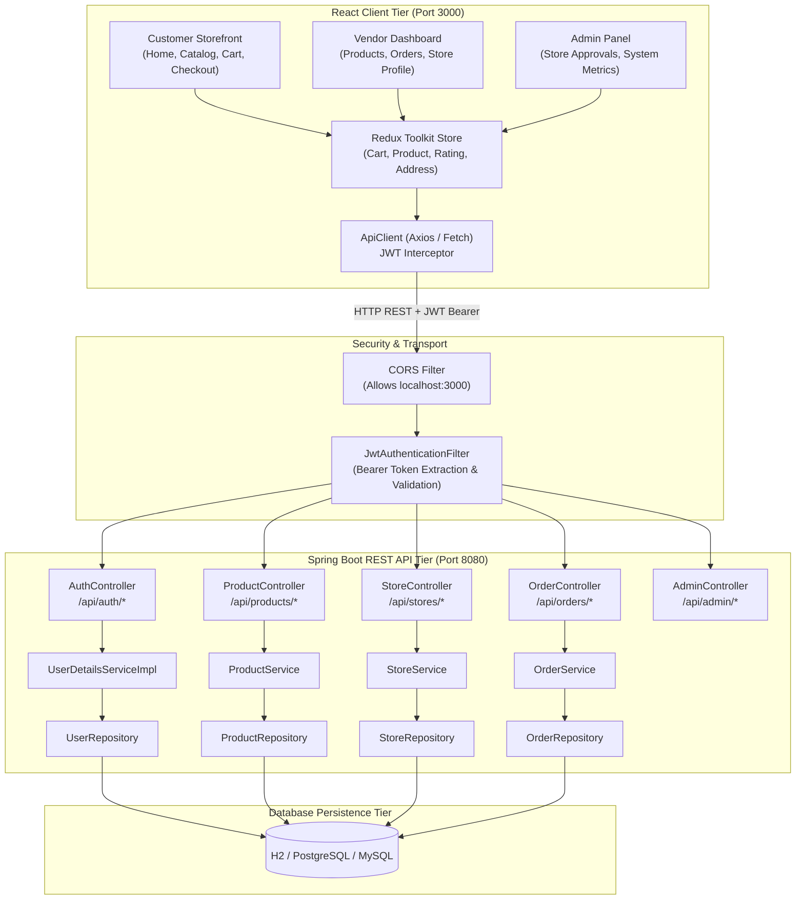
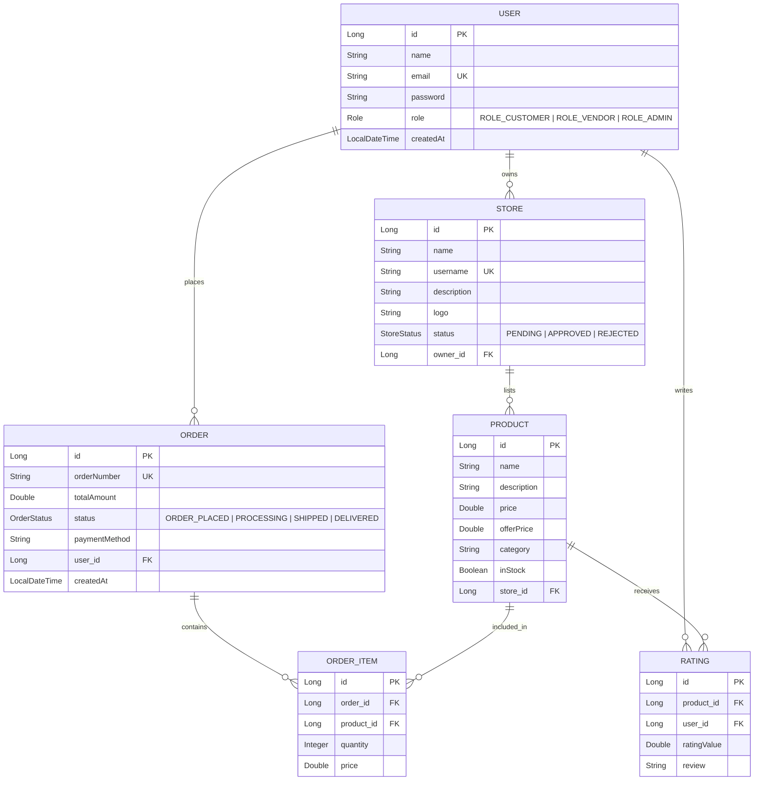

# GoCart Full-Stack E-Commerce System
## React 19 + Spring Boot 3.4 Architecture & Implementation

---

## 1. Executive Summary

**GoCart** is a production-grade, multi-vendor e-commerce platform architected as a decoupled full-stack application.
- **Frontend Layer:** Built using **React (Next.js 15 App Router)**, **Redux Toolkit**, and **Tailwind CSS**, delivering modern, responsive portals for Shoppers, Store Vendors, and Platform Administrators.
- **Backend Layer:** Powered by **Spring Boot 3.4**, implementing a secure, stateless RESTful API with **Spring Security 6**, **JJWT (JSON Web Token)**, **Spring Data JPA**, **Hibernate ORM**, **Jakarta Validation**, and **Springdoc-OpenAPI (Swagger UI)**.

---

## 2. Technology Stack & Frameworks

### 2.1 Frontend Ecosystem
* **Core Library:** React 19 (App Router, Server/Client Components, React Hooks)
* **Meta-Framework:** Next.js 15 with Turbopack bundler
* **Global State Management:** Redux Toolkit (`@reduxjs/toolkit`, `react-redux`)
* **Styling & Design System:** Tailwind CSS v4, Lucide Icons (`lucide-react`)
* **Feedback & Visualization:** React Hot Toast, Recharts
* **API Integration:** Async Redux Thunks + Modular `ApiClient` supporting JWT Bearer authentication

### 2.2 Backend Ecosystem (Spring & Java)
* **Framework:** Spring Boot 3.4.1 (Java 17 / 21)
* **Web & Routing:** Spring Boot Starter Web (Spring MVC, Jackson, RESTful Controllers)
* **Security & Auth:** Spring Security 6 + JJWT 0.12 (Stateless JWT token filter, Role-Based Access Control)
* **ORM & Persistence:** Spring Data JPA + Hibernate (Declarative repositories, `@Entity`, `@OneToMany`, `@ManyToOne`)
* **Data Validation:** Spring Boot Starter Validation (Hibernate Validator, `@Valid`, `@NotBlank`, `@Email`)
* **Documentation:** Springdoc-OpenAPI 2.8 (`/swagger-ui.html`, OpenAPI 3.0 specs)
* **Production Observability:** Spring Boot Actuator (`/actuator/health`, `/actuator/metrics`)
* **Database Drivers:** H2 (in-memory dev), MySQL Connector/J, PostgreSQL driver

---

## 3. High-Level Architecture



---

## 4. Entity-Relationship & Data Model



---

## 5. REST API Specifications

| Method | Endpoint | Access Level | Description |
|---|---|---|---|
| `POST` | `/api/auth/register` | Public | Create a customer/vendor account |
| `POST` | `/api/auth/login` | Public | Authenticate user & receive JWT token |
| `GET` | `/api/auth/me` | Authenticated | Fetch current profile & role |
| `GET` | `/api/products` | Public | List products (supports `?category=...`) |
| `GET` | `/api/products/{id}` | Public | Retrieve single product details |
| `GET` | `/api/products/search?q=...` | Public | Keyword search across catalog |
| `POST` | `/api/products` | Vendor / Admin | Add new product listing |
| `GET` | `/api/stores` | Public | List approved public vendor stores |
| `POST` | `/api/stores/create` | Authenticated | Register a new vendor store |
| `POST` | `/api/orders` | Authenticated | Place checkout order |
| `GET` | `/api/orders/my-orders` | Authenticated | Retrieve user order history |
| `GET` | `/api/admin/stores/pending` | Admin Only | View pending vendor store applications |
| `PATCH` | `/api/admin/stores/{id}/status` | Admin Only | Approve or reject store application |
| `GET` | `/api/admin/stats` | Admin Only | Retrieve platform analytics summary |
| `GET` | `/swagger-ui.html` | Public | Interactive OpenAPI Documentation |
| `GET` | `/h2-console` | Public (Dev) | H2 Web Database Console |

---

## 6. How to Run

### Step 1: Run the React Frontend
```powershell
cd c:\Users\siddh\Downloads\gocart-main\gocart-main
npm run dev
```
Accessible at: **http://localhost:3000**

### Step 2: Run the Spring Boot Backend
```powershell
cd c:\Users\siddh\Downloads\gocart-main\gocart-backend
mvn spring-boot:run
```
* API Server: **http://localhost:8080**
* Swagger UI Docs: **http://localhost:8080/swagger-ui.html**
* H2 Database Console: **http://localhost:8080/h2-console** (JDBC URL: `jdbc:h2:mem:gocartdb`)

### Default Seed Credentials
* **Admin:** `admin@gocart.com` / `admin123`
* **Vendor:** `vendor@gocart.com` / `vendor123`
* **Customer:** `customer@gocart.com` / `customer123`

